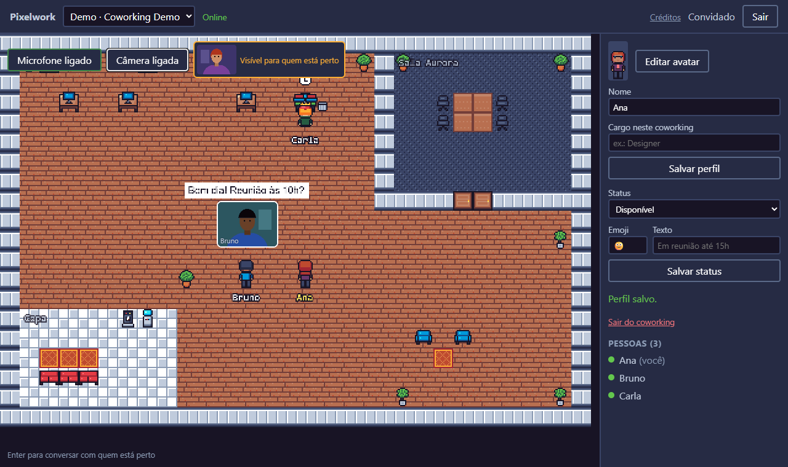
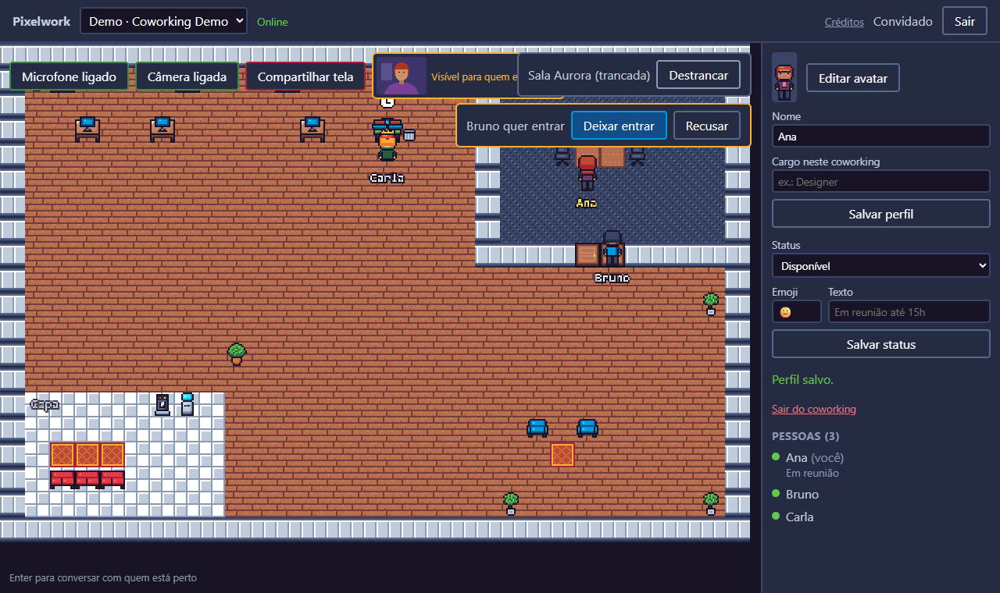
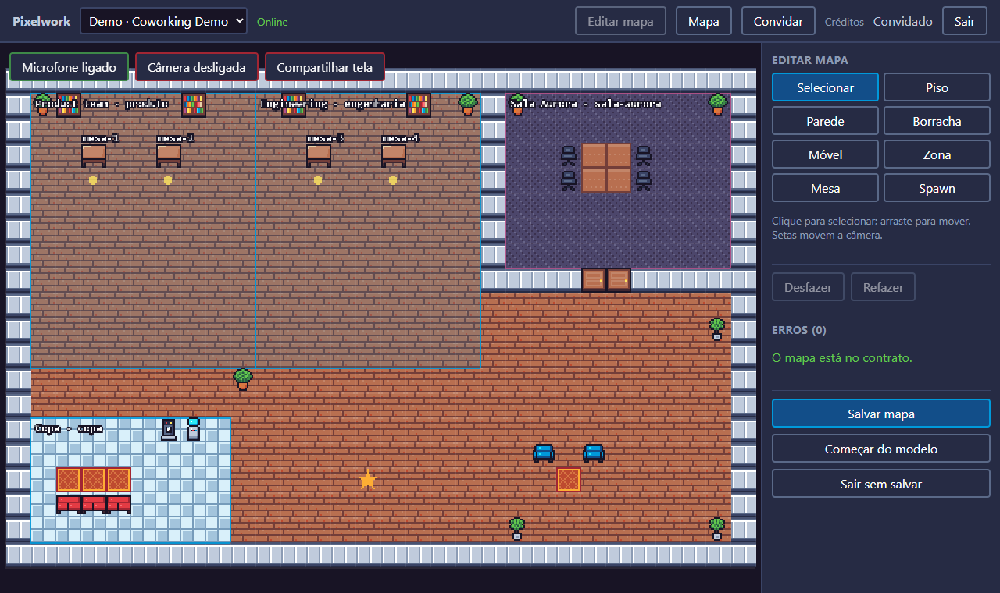
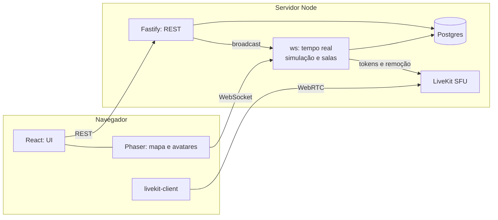

# Pixelwork

Coworking virtual 2D em pixel art. Empresas têm coworkings com mapa próprio; as pessoas andam pelo
mapa, conversam por áudio e vídeo com quem está perto, decoram a própria mesa, entram em salas de
reunião que podem ser trancadas e fazem chamadas a partir da mesa.

Projeto de portfólio. O foco é o núcleo de tempo real: servidor autoritativo, predição no cliente,
proximidade e autorização de mídia feitas no servidor.



## O que dá para fazer

- Entrar como convidado (ou com o GitHub) e andar pelo coworking de demonstração, vendo os outros
  com movimento suave.
- Chegar perto de alguém liga o áudio e o balão de vídeo; se afastar desliga. Chat em balão para
  quem está perto.
- Salas de reunião viram salas de mídia separadas: trancar, bater na porta, aprovar. Quem é
  recusado não recebe nem o token da sala.
- Chamada 1:1 a partir da própria mesa, com qualquer pessoa do coworking; compartilhamento de tela
  em reuniões e chamadas.
- Status, emoji, cargo por coworking, avatar por camadas com troca de paleta, mesa decorável.
- Várias empresas e coworkings por conta, convites com limite de usos e validade.
- Mapas: upload do JSON do Tiled, export em zip que volta a abrir no Tiled, editor dentro do app
  com desfazer e refazer. Quem está online vê o mapa novo sem recarregar.

## Telas

| | |
|---|---|
|  |  |
| Sala trancada: quem bate na porta espera a aprovação de quem está dentro. | Editor de mapa no app, validado pelo mesmo `compileMap` do upload. |
|  |  |
| Avatar por camadas: corpo, roupa, cabelo e acessório, com as cores trocadas no cliente. | Mesa própria com variação, tela e itens por posição. |

Os prints saem de `docs/prints/`, gerados com três convidados no coworking de demo e câmeras
falsas do Chromium.

## Como rodar

Precisa de Node 24, pnpm 11 e Docker.

```
cp .env.example .env
pnpm install
docker compose -f docker-compose.dev.yml up -d
pnpm db:migrate
pnpm db:seed
pnpm dev
```

Abrir http://localhost:5173 e entrar como convidado. Para ver outra pessoa, abrir num segundo
perfil do navegador (o cookie é por perfil). O login pelo GitHub é opcional; o passo a passo está no
`.env.example`.

Outros comandos: `pnpm test` (unitários e integração, com o Postgres do compose), `pnpm e2e`,
`pnpm load --bots 50`, `pnpm typecheck`, `pnpm lint`. A lista completa está no `CLAUDE.md`.

## Arquitetura



- **Monorepo** com `shared` (protocolo, schema, compilação do mapa, simulação, proximidade, modelo
  do editor), `server` e `client`. A simulação e as regras de proximidade são funções puras em
  `shared`, usadas pelos dois lados e testadas sem rede nem relógio.
- **Movimento:** o cliente manda intenção (`move` com direção e `seq`), nunca posição. O servidor
  aplica no máximo um passo por intervalo e confirma com `ack` no tick; o cliente prevê, faz snap e
  reaplica os passos pendentes quando diverge. Os outros avatares são interpolados.
- **Persistido x efêmero:** o que vai para o banco passa por REST (grava e depois avisa pelo
  WebSocket); movimento, trancas, batidas, chamadas e chat passam só pelo WebSocket.
- **Mídia:** cada cliente está em uma sala do LiveKit por vez, e quem decide qual é o servidor
  (`space:` aberta, `zone:` da reunião, `call:` da chamada). Ao trocar, o servidor emite o token
  novo e remove o participante da sala anterior pela API do LiveKit, o que cobre um cliente
  modificado que ignore o aviso.
- **Mapa:** o formato é o JSON do Tiled, com um contrato validado por `compileMap` (camadas,
  zonas, mesas, spawn, tilesets do catálogo). Upload, editor e templates produzem o mesmo JSON.

Os contratos completos estão em `docs/architecture.md`; a arte e o catálogo de assets, em
`docs/art.md`.

## Decisões e o que ficou de fora

| Escolha | Descartado | Por quê |
|---|---|---|
| Sessão própria, token aleatório com só o hash no banco | JWT, auth como serviço | Revogar é apagar a linha; nenhum serviço externo precisa validar o token |
| LiveKit (SFU) self-hosted | Mesh P2P, mediasoup | Mesh multiplica o upload por participante; mediasoup é baixo nível demais |
| Proximidade calculada no cliente para a sala aberta | Calcular no servidor | A área aberta é visível para todos por definição; o que precisa de privacidade está em salas separadas, autorizadas no servidor |
| Drizzle + Postgres, isolamento de tenant na aplicação | Prisma, RLS, schema por tenant | Schema em TypeScript sem codegen; um backend só não ganha nada com RLS |
| Toda rota `/spaces/:id` resolve a participação uma vez e responde 404 a quem não é membro | 403 | Não vaza a existência do coworking; um teste deriva a lista de rotas do Fastify e falha se uma rota nova ficar de fora |
| Vídeo como `<video>` sobre o canvas | Vídeo como textura no Phaser | Upload de textura por frame sem ganho |
| Concorrência otimista no mapa (`baseVersion`, 409) | Lock de edição | Dois admins raramente editam juntos; o 409 é simples de explicar |
| Vitest, bots em Node com os tipos do protocolo | Jest, k6, Artillery | Sem configuração extra de TypeScript; o teste de carga usa o protocolo real |

## Números de carga

`pnpm load --bots N` sobe o servidor num processo filho, entra N convidados no coworking de demo e
faz cada um andar aleatoriamente (um passo a cada ~160 ms). A latência é do tick: do envio pelo
servidor (`ts` do tick) ao recebimento pelo bot. Medido numa máquina de desenvolvimento Windows,
com servidor e bots na mesma máquina, 30 s de medição depois de 5 s de aquecimento:

| Bots | Latência p50 | p95 | p99 | Tick médio | Mensagens por bot/s | CPU do servidor | Memória (RSS) |
|-----:|-----:|-----:|-----:|-----:|-----:|-----:|-----:|
| 10 | 7 ms | 8 ms | 9 ms | 347 B | 9,5 | 3,8% | 97 MB |
| 25 | 3 ms | 4 ms | 6 ms | 810 B | 9,7 | 5,8% | 98 MB |
| 50 | 6 ms | 9 ms | 12 ms | 1.555 B | 9,9 | 8,9% | 102 MB |

O tick cresce linearmente com quem se moveu (todo o coworking vai para todos, sem área de
interesse), e a CPU fica abaixo de 10% de um núcleo com 50 pessoas andando sem parar. Os bots
rodam num único processo Node, então parte da latência é fila do próprio cliente de teste.

## Testes

- Unitários: `compileMap` com uma fixture por código de erro, simulação, proximidade com histerese,
  reconciliação, interpolação, validação, comandos do editor (ida e volta exata e sequências
  aleatórias com semente fixa).
- Integração: servidor no processo de teste, porta aleatória, relógio manual e banco criado e
  apagado por execução. Bots WebSocket cobrem entrada, saída, tolerância de reconexão, limites de
  taxa, trancas, batidas, chamadas e a autorização de mídia contra um dublê do LiveKit.
- E2E de fumaça (Playwright, dois contextos do Chromium com mídia falsa): um anda até o outro e o
  teste confere que a trilha remota foi assinada. Roda no CI com o LiveKit num container.
- Renderização do Phaser e layout do React não têm teste automatizado; a lógica fica fora das
  cenas.

## Limites conhecidos e o caminho para escalar

Hoje é um nó só: o estado de tempo real (posições, trancas, chamadas) vive na memória do processo,
e um coworking inteiro recebe os movimentos de todos. Para crescer:

1. **Coworkings distribuídos entre nós:** cada coworking pertence a um nó (hash do id); o
   balanceador encaminha o WebSocket pelo `space`. O estado continua em memória, só que espalhado.
2. **Avisos entre nós:** a rota REST grava no banco e publica num Redis; o nó dono do coworking
   faz o broadcast.
3. **Área de interesse:** mandar no tick só quem está perto da câmera de cada cliente, quando um
   coworking passar de algumas centenas de pessoas.
4. **LiveKit em cluster:** o LiveKit já escala horizontalmente com Redis; o servidor só emite
   tokens.

O deploy numa VPS está preparado (Caddy com TLS, app, Postgres, LiveKit), mas não foi feito; ver
`docs/deploy.md`.

## Arte

A arte é gerada em código (`pnpm assets:art`, a partir de `scripts/art/`), na paleta Endesga 32 e
no layout final dos spritesheets; peça desenhada à mão substitui a gerada sem mudar código. Licenças aceitas e créditos em
`docs/art.md` e na página `/creditos` do app.
