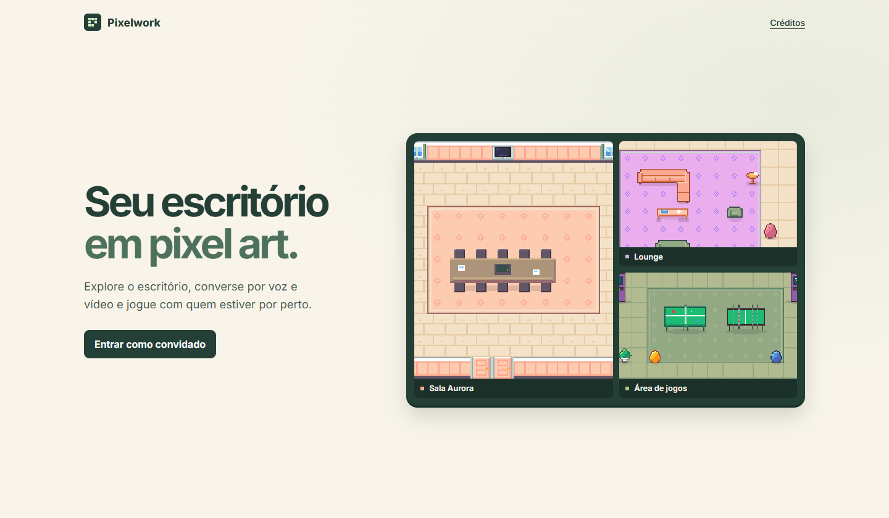
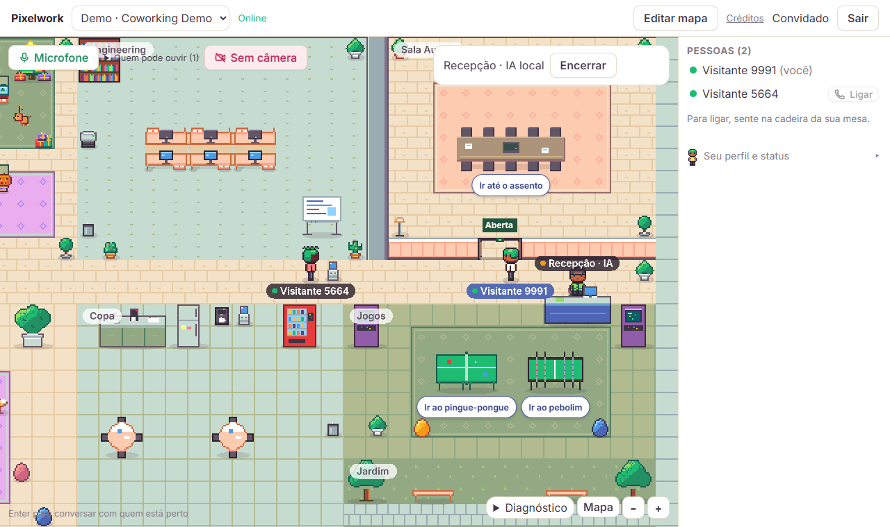
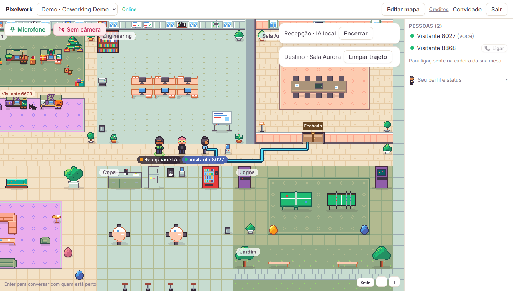
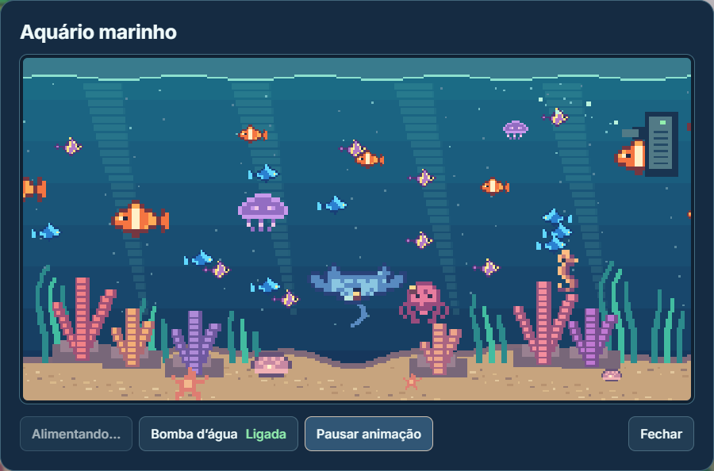
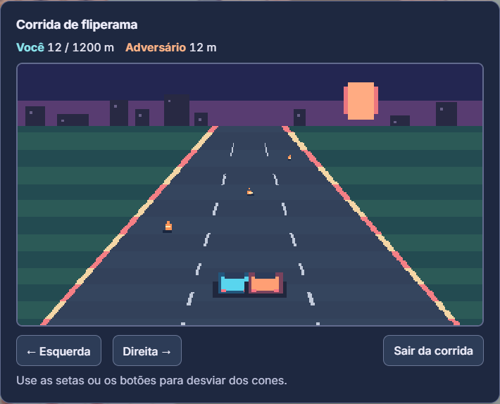
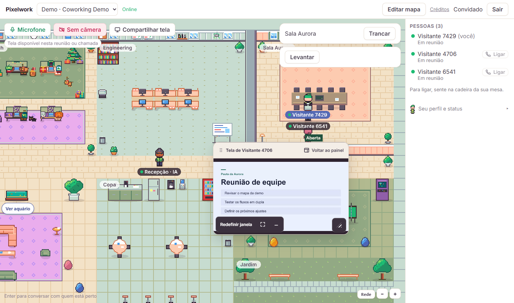
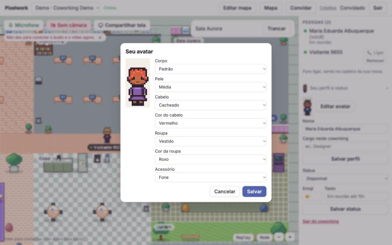
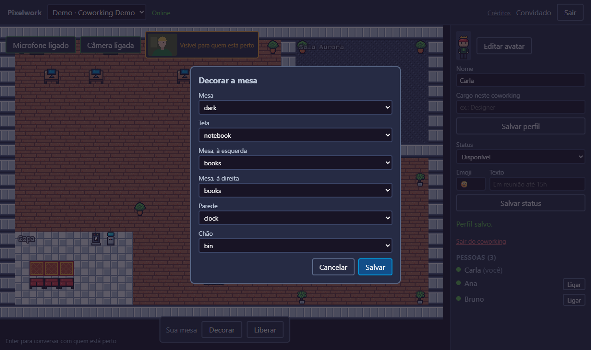
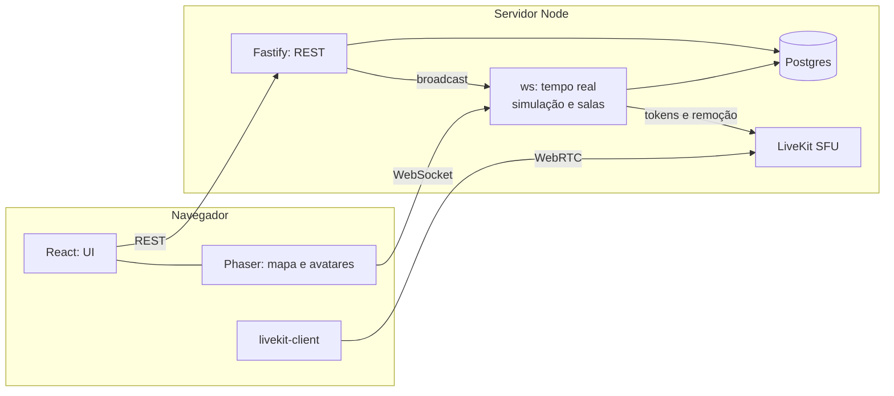

# Pixelwork

Coworking virtual em pixel art 2D com voz e vídeo por proximidade, mapas personalizáveis e uma recepcionista de IA com voz local em português.

[Como rodar](#como-rodar) · [Telas](#telas) · [Buscar destinos no mapa](#buscar-destinos-no-mapa) · [Recepcionista com voz local](#recepcionista-com-voz-local) · [Arquitetura](#arquitetura) · [Testes](#testes)

## O que dá para fazer

- **Explorar e jogar.** Use o teclado, toque no mapa ou abra **Mapa** para buscar salas, mesas e pessoas. Sente-se nos móveis e jogue pingue-pongue ou pebolim contra outra pessoa ou um bot.
- **Aquário e fliperamas.** Alimente os animais do recife ou dispute uma corrida de carros nos dois fliperamas.
- **Conversar e se reunir.** Use chat por proximidade, chamadas 1:1, compartilhamento de tela e salas privadas com pedido de acesso. A recepcionista também traça rotas até salas, mesas e pessoas.
- **Personalizar e editar.** Monte avatares e mesas com coleções temáticas e reorganize o escritório no editor com desfazer e refazer. Visitantes da demo editam uma cópia da aba. Administradores podem importar, exportar e restaurar versões publicadas em **Gerenciar mapa**.
- **Gerenciar espaços.** Crie coworkings por organização, convide pessoas e defina papéis.

## Telas

### Prévia antes do login



### Atendimento por voz local



### Rota até a sala Aurora



[Como pedir uma rota por texto](#pedir-uma-rota-por-texto) · [Como pedir uma rota por voz](#pedir-uma-rota-por-voz)

### Aquário e fliperamas

| Aquário durante a alimentação | Corrida com dois jogadores |
| --- | --- |
|  |  |

[Como jogar 1x1 nos fliperamas](#corrida-1x1-nos-fliperamas)

### Compartilhamento de tela na Sala Aurora



Na captura, **Redefinir janela** restaurou a posição e o tamanho padrão sem interromper o vídeo.

[Como compartilhar a tela](#compartilhar-a-tela)

### Mapa, personalização e ações


| Sala Aurora | Editor de mapas |
| --- | --- |
|  |  |

| Personalização de avatar | Decoração da mesa |
| --- | --- |
|  |  |

| Destinos no celular | Ações no mapa |
| --- | --- |
|  |  |

Capturas da demo local.

## Como rodar

Precisa de Node 24, pnpm 11 e Docker.

```
cp .env.example .env
pnpm install
docker compose -f docker-compose.dev.yml up -d
pnpm db:migrate
pnpm db:seed
pnpm dev
```

Abra http://localhost:5173 e entre como convidado. Use um segundo perfil do navegador para testar
com dois usuários. O login opcional pelo GitHub está documentado no `.env.example`. O mapa da
demo é restaurado diariamente à meia-noite no horário de Brasília.

### Testar com outra pessoa na rede

Fora do `localhost` o navegador só libera câmera e microfone em https, e a outra máquina precisa
achar o Vite e o LiveKit pelo IP desta. Com o IP desta máquina no lugar de `192.168.0.10`:

1. Gerar um certificado próprio (o Git para Windows já traz o `openssl`):

   ```
   mkdir .certs
   openssl req -x509 -newkey rsa:2048 -nodes -days 365 -keyout .certs/dev.key -out .certs/dev.crt \
     -subj "/CN=Pixelwork dev" -addext "subjectAltName=IP:192.168.0.10,DNS:localhost,IP:127.0.0.1"
   ```

2. Descomentar o bloco "Outra pessoa na mesma rede" do `.env` (está no `.env.example`) com o IP.
3. Recriar o LiveKit para ele anunciar o IP (`docker compose -f docker-compose.dev.yml up -d livekit`)
   e subir com `pnpm dev`.
4. Todo mundo abre `https://192.168.0.10:5173`, inclusive nesta máquina: o servidor só aceita
   escrita vinda do `PUBLIC_URL`. O navegador avisa que o certificado não é confiável; aceitar uma
   vez.

O firewall precisa deixar entrar TCP 5173 (Vite), TCP 7881 e UDP 7882 (mídia do LiveKit). Https em
`localhost` ou IP privado continua sendo desenvolvimento: as checagens de produção do `env.ts` valem
para https em endereço público.

O banco de desenvolvimento fica em `127.0.0.1:5432`. Se o contêiner já existia antes dessa configuração, recrie o serviço `postgres` com o mesmo projeto Compose para aplicar o vínculo local.

O microfone começa desligado. Depois de ativá-lo, abra **Quem pode ouvir** para ver a lista de pessoas autorizadas na sala ou por proximidade.

### Compartilhar a tela

Entre em uma sala de reunião, como a **Sala Aurora**, ou inicie uma chamada privada. Para ligar, sente-se na cadeira da sua mesa, clique em **Ligar** na lista de pessoas e aguarde a outra pessoa atender. Em seguida, clique em **Compartilhar tela** ao lado dos controles de microfone e câmera e escolha o que apresentar no navegador.

Você pode compartilhar em pé. Só os participantes da reunião ou chamada veem a apresentação. Use **Parar de compartilhar** ou saia da sala para encerrar.

#### Ver uma apresentação em tela cheia

1. Na **Sala Aurora** ou em uma **chamada privada**, espere a apresentação aparecer sobre o mapa.
2. Clique em **Tela cheia** no rodapé do vídeo. Na janela flutuante, esse controle é o ícone de quatro cantos na barra inferior.
3. Para voltar ao mapa, clique em **Sair da tela cheia**. Se a apresentação ou a chamada terminar, o mapa volta automaticamente.

#### Minimizar e restaurar uma apresentação

1. Ao receber uma apresentação na **Sala Aurora** ou em uma **chamada privada**, clique em **Minimizar** no rodapé do vídeo. Na janela flutuante, use o ícone de traço na barra inferior. O botão também funciona em tela cheia.
2. O vídeo se recolhe para liberar o mapa, e o compartilhamento continua ativo.
3. Para voltar ao vídeo, clique em **Restaurar apresentação** na barra abaixo dos controles de mídia.

#### Acompanhar uma apresentação em modo flutuante

1. Ao receber uma apresentação na **Sala Aurora** ou em uma **chamada privada**, clique em **Flutuante** no rodapé do vídeo para acompanhar a apresentação e o mapa ao mesmo tempo.
2. Arraste a barra de título, marcada com uma alça ao lado do nome de quem apresenta, com o mouse ou por toque. Pelo teclado, coloque o foco em **Mover** e use as setas.
3. Arraste a alça no **canto inferior direito** para fora para ampliar a janela ou para dentro para reduzi-la. Pelo teclado, coloque o foco na alça **Redimensionar apresentação** e use as setas. O vídeo continua rodando durante o ajuste.
4. Clique em **Voltar ao painel**, na barra de título, para retomar a visualização normal da mesma apresentação.

O Pixelwork salva a posição e o tamanho da janela no navegador. Depois de clicar em **Voltar ao painel**, selecione **Flutuante** novamente para recuperar o último ajuste. No mesmo navegador, ele também vale para novas apresentações na Sala Aurora ou em chamadas privadas, inclusive após recarregar a página.

Para restaurar a posição e o tamanho padrão, clique em **Redefinir janela** na barra inferior da janela flutuante. O vídeo continua rodando, e o padrão substitui o ajuste salvo no navegador.

## Buscar destinos no mapa

1. No computador ou no celular, abra **Mapa**, perto dos controles de zoom.
2. No campo **Buscar sala, mesa ou pessoa**, digite `Aurora`, `mesa-3` ou o nome de alguém online em uma área aberta.
3. Escolha um resultado para caminhar até ele. Para salas de reunião, o trajeto termina na porta. Se a sala estiver trancada, use **Bater na porta** e aguarde a autorização.

### Copiar o link da Sala Aurora

1. Em **Mapa**, procure por `Aurora` e clique em **Copiar link** ao lado de **Sala Aurora**.
2. Envie o endereço a alguém com acesso ao mesmo coworking. Ao abrir o link no navegador, a pessoa vê o caminho destacado até a porta. A entrada continua sujeita à tranca da sala.

Se o navegador bloquear a cópia automática, copie o endereço exibido no campo **Link da sala**.

## Corrida 1x1 nos fliperamas

1. Entrem como convidados no mesmo coworking. Para testar em dois dispositivos, usem [a demo na mesma rede](#testar-com-outra-pessoa-na-rede).
2. Na área de jogos, cada pessoa vai até um fliperama diferente e escolhe **Jogar corrida**. Quem entra primeiro fica na sala de espera. A contagem regressiva começa quando o segundo jogador entra pela outra máquina.
3. Segurem **↑** para acelerar e **↓** para frear. Usem **←** e **→** para desviar dos cones e **Shift** para o turbo, que recarrega após o uso. Os botões na tela também funcionam por toque. Vence quem cruzar primeiro a linha dos **1.200 m**.

Para praticar sozinho, escolha **Jogar sozinho** na sala de espera.

## Recepcionista com voz local

Na demo, a recepcionista fica sentada atrás do balcão na ponta direita do corredor central quando a instalação e o coworking ativam o recurso. Use **Ir à recepção** no guia inicial ou busque **Recepção** pelo botão **Mapa**.

### Pedir uma rota por texto

1. Aproxime-se da **Recepção · IA** e escolha **Perguntar por texto**. Você pode manter o microfone desligado.
2. Em **Sua pergunta**, digite “Onde fica a Sala Aurora?” e clique em **Perguntar**. Você também pode perguntar por uma mesa ou pelo nome de alguém online em uma área aberta.
3. Quando a recepção localizar o destino, clique em **Ver trajeto no mapa**. Siga a linha azul e use **Limpar trajeto** para removê-la quando quiser.

### Pedir uma rota por voz

1. Aproxime-se da **Recepção · IA**, ative o microfone e toque em **Conversar com IA**. Pergunte “Onde fica a Sala Aurora?”. Você também pode pedir “Onde fica a mesa 3?” ou “Onde está [nome da pessoa]?”.
2. Siga o trajeto azul. O caminho para uma sala de reunião termina na porta. A busca por pessoa destaca quem está online em uma área aberta e fora de chamada.
3. Para encerrar, use **Encerrar** ou afaste-se. O trajeto continua no mapa após o atendimento. Use **Limpar trajeto** para removê-lo.

O Pixelwork supervisiona o processo Python via IPC. A trilha de voz é exclusiva do visitante
atendido, e o servidor remove a identidade do NPC ao encerrar. A fala do visitante interrompe a
reprodução. Áudio e transcrições são processados em memória, e os logs guardam contadores de uso.
Há um atendimento por coworking, um limite global e uma cota diária por coworking. O servidor reserva a duração máxima de cada sessão na cota do dia UTC. Os contadores de áudio e tokens registram o uso observado separadamente.
[Spec da recepção](docs/superpowers/specs/2026-11-25-recepcionista-ia-design.md)

### Preparar a recepção na demo

1. Crie um ambiente Python 3.12 fora da pasta do projeto e instale o SDK livre com `python -m pip install livekit==1.3.0`.
2. Aplique `pnpm db:migrate` no banco de desenvolvimento. No `.env`, defina `RECEPTIONIST_ENABLED=true` e `RECEPTIONIST_PYTHON` como o caminho absoluto do executável desse ambiente. Os limites de sessões, duração e cota diária estão no `.env.example`.
3. Entre no coworking como admin, abra **Recepção** e autorize o recurso. A demo restaurada a partir do mapa padrão inclui o ponto. Em outro mapa, adicione no Tiled um ponto em uma camada de objetos chamada `reception`, em área aberta e caminhável.

### Usar voz local em português

Faster Whisper transcreve, Qwen interpreta a pergunta e Piper fala a resposta. O servidor
consulta o estado do coworking para as intenções permitidas.

1. No mesmo ambiente Python do passo anterior, instale `python -m pip install faster-whisper==1.2.1 piper-tts==1.3.0`.
2. Baixe os arquivos públicos de [Faster Whisper Small](https://huggingface.co/Systran/faster-whisper-small/tree/main) (`config.json`, `model.bin`, `tokenizer.json` e `vocabulary.txt`) para a subpasta `whisper-small` do diretório de modelos. Salve `pt_BR-faber-medium.onnx` e `pt_BR-faber-medium.onnx.json` da [voz Piper Faber](https://huggingface.co/rhasspy/piper-voices/tree/main/pt/pt_BR/faber/medium) na raiz desse diretório.
3. Baixe o [llama.cpp](https://github.com/ggml-org/llama.cpp/releases) para a sua máquina e o arquivo [Qwen2.5-1.5B-Instruct Q4_K_M](https://huggingface.co/Qwen/Qwen2.5-1.5B-Instruct-GGUF). Inicie o modelo com `llama-server --model caminho/qwen2.5-1.5b-instruct-q4_k_m.gguf --host 127.0.0.1 --port 8099 --ctx-size 2048 --log-disable`.
4. No `.env`, defina `RECEPTIONIST_LOCAL_MODELS_DIR` como o caminho absoluto do diretório de modelos e `RECEPTIONIST_LOCAL_LLM_URL=http://127.0.0.1:8099`. Reinicie o Pixelwork.

Com as duas variáveis vazias, a recepção usa os dublês de teste e responde com tons sintéticos.

### Tempo até o primeiro áudio sintético

Após aquecer a conversa, o teste mediu do fim do trecho no publicador ao primeiro frame audível no
receptor RTC Python. Foram 30 turnos sem erro, com STT, LLM e TTS simulados. O ambiente foi a
mesma máquina Windows do ensaio abaixo, com RTC Python 1.3.0.

| Turnos | p50 | p95 | Faixa |
| ---: | ---: | ---: | ---: |
| 30 | 312 ms | 328 ms | 265–344 ms |

Reproduza com `pnpm exec tsx scripts/reception-worker-smoke.ts caminho/do/python 30`. O teste de
isolamento de mídia está em `scripts/reception-rtc-smoke.ts`.

### Latência da resposta com voz local no navegador

O Chrome mede do fim da pergunta ao primeiro bloco audível na trilha do LiveKit, pelo relógio Web
Audio. O teste usa quatro perguntas sintetizadas e exclui a saudação e um turno de aquecimento por
sessão. Os percentis usam o método do posto mais próximo.

O ensaio de 25/11/2026 rodou em uma máquina Windows 11 Pro com Ryzen 7 7735HS, Chrome
157.0.8103.79, Node 24.14.1, Python 3.12.13 e LiveKit v1.13.11 no Docker Desktop.
Faster Whisper Small INT8, Qwen 2.5 1.5B Q4_K_M via llama.cpp e Piper Faber rodaram em CPU.
A medição termina antes da saída física de som.

| Versão | Turnos medidos | Sem resposta | p50 | p95 |
| --- | ---: | ---: | ---: | ---: |
| Linha de base (`5ea0376`) | 20 | 0 | 5,44 s | 7,18 s |
| Voz local otimizada | 20 | 0 | 4,48 s | 5,11 s |

O Whisper passou a decodificar com feixe único e sem timestamps, usando até oito threads conforme a máquina. A trilha começa a receber áudio assim que o Piper sintetiza a primeira frase. Neste ensaio, o p50 caiu 18% e o p95 caiu 29%.

Em 26/11/2026, no mesmo PC e com os mesmos modelos, o ensaio no Chrome 157.0.8103.79 mediu 10 turnos aquecidos. O p50 foi **4,09 s** e o p95 **4,62 s**, com 0 falhas. As duas sessões usaram um novo processo de voz e o servidor llama.cpp já em execução. Do clique à saudação, os tempos foram **10,40 s** e **4,37 s**. A primeira pergunta após cada saudação levou **6,23 s** e **4,26 s** até a resposta começar. Foram 0 falhas de inicialização. A amostra de duas sessões registra os valores individuais de início.

O endpoint interno `/metrics` expõe o tempo até o worker ficar pronto e eventos de sessão, como indisponibilidade, tempo limite e cota diária atingida. O benchmark no Chrome ainda mede até a chegada do áudio.

Para reproduzir, execute com a demo de voz ativa.

```bash
node scripts/reception-browser-bench.ts http://127.0.0.1:5200 caminho/do/python caminho/pt_BR-faber-medium.onnx 20
```

## Arquitetura



- **Monorepo.** `shared` reúne protocolo, schema, compilação de mapas e regras de simulação
  usadas pelo cliente e pelo servidor.
- **Movimento e mídia.** O servidor confirma os passos no tick, autoriza as salas do LiveKit e
  remove o participante da sala anterior. O cliente prevê os próprios passos e interpola os
  demais avatares.
- **Estado.** O REST grava dados persistentes e avisa via WebSocket, que também transporta
  movimento, chat, trancas e chamadas.

[Contratos e detalhes da arquitetura](docs/architecture.md)

## Decisões de implementação

- **Sessões e acesso.** O banco guarda o hash do token. Excluir a sessão revoga o acesso.
  Rotas de coworking devolvem 404 a quem está fora do espaço.
- **Renderização.** O LiveKit atua como SFU e o vídeo fica em elementos HTML sobre o canvas.
- **Edição concorrente.** O editor usa `baseVersion` e recebe 409 se o mapa mudou desde a abertura.

## Números de carga

`pnpm load --bots N` conecta convidados que andam a cada ~160 ms e mede do envio do tick ao
recebimento pelo bot. O ensaio com JSON rodou em Windows, com servidor e bots na mesma máquina,
por 30 s após 5 s de aquecimento.

| Bots | Latência p50 | p95 | p99 | Tick médio | Mensagens por bot/s | CPU do servidor | Memória (RSS) |
|-----:|-----:|-----:|-----:|-----:|-----:|-----:|-----:|
| 10 | 7 ms | 8 ms | 9 ms | 347 B | 9,5 | 3,8% | 97 MB |
| 25 | 3 ms | 4 ms | 6 ms | 810 B | 9,7 | 5,8% | 98 MB |
| 50 | 6 ms | 9 ms | 12 ms | 1.555 B | 9,9 | 8,9% | 102 MB |

Os bots compartilham um processo Node, cuja fila também entra na latência medida.

Na comparação de novembro de 2026 em macOS, com 20 s de medição, o tick médio com 50 bots caiu de
1.559 B em JSON para 154 B em binário. O servidor usou 4,1% de CPU com JSON e 5,0% com binário.

| Bots | Latência p50 | p95 | p99 | Tick médio | Mensagens por bot/s | CPU do servidor |
|-----:|-----:|-----:|-----:|-----:|-----:|-----:|
| 10 | 0 ms | 1 ms | 1 ms | 44 B | 9,9 | 1,7% |
| 25 | 1 ms | 1 ms | 1 ms | 86 B | 10,3 | 3,4% |
| 50 | 1 ms | 2 ms | 2 ms | 154 B | 10,2 | 5,0% |

Em 27/11/2026, com as listas de audiência da mídia ativas, o ensaio local em Windows 11 Pro
(Ryzen 7 7735HS, Node 24.14.1) registrou 9.350 ticks em 20 s com 50 bots e 5 s de aquecimento.
O tick binário teve média de **158 B**, p50 de **7 ms** e p95 de **9 ms**. Incluindo as mensagens
de controle, a média foi de **161 B** e **12 mensagens por bot/s**. O processo do servidor
usou **10% de CPU** e **103 MB** de RSS durante o ensaio.

## Testes

- `pnpm test` roda os unitários e a integração com o Postgres do Compose e um dublê do LiveKit.
  Os testes cobrem regras do mapa e do editor, simulação, reconexão e autorização de mídia.
- `pnpm e2e` verifica no Chromium o áudio por proximidade e a apresentação na Aurora com dois participantes e um terceiro fora da sala. O CI usa LiveKit em contêiner e captura de mídia simulada.
- `pnpm typecheck` e `pnpm lint` verificam tipos e estilo.

[Comandos do projeto](CLAUDE.md) · [Detalhes dos testes](docs/architecture.md#14-testes)

## Limites conhecidos e o caminho para escalar

Um processo guarda posições, trancas e chamadas em memória. Cada coworking recebe os movimentos
de todos os seus participantes. Para escalar, o plano é distribuir coworkings entre nós, usar Redis
para avisos entre processos e limitar os ticks à área visível em espaços maiores. O LiveKit pode
rodar em cluster.

[Guia de deploy em uma VPS](docs/deploy.md)

## Arte

A pixel art usa a paleta Resurrect 64. Gere os assets com `pnpm assets:art`. Os créditos também
estão em `/creditos` no app. [Guia de arte e licenças](docs/art.md)
