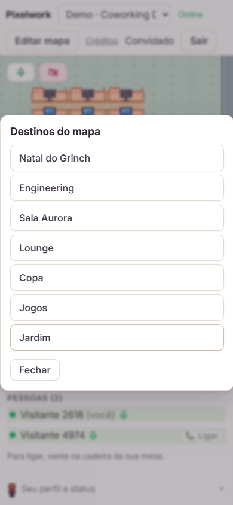
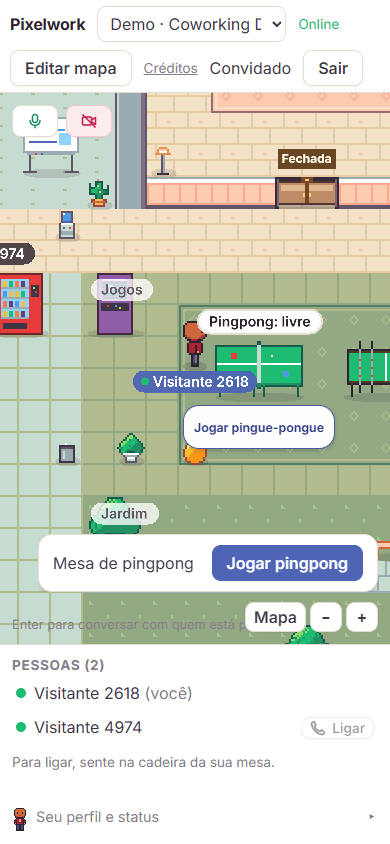
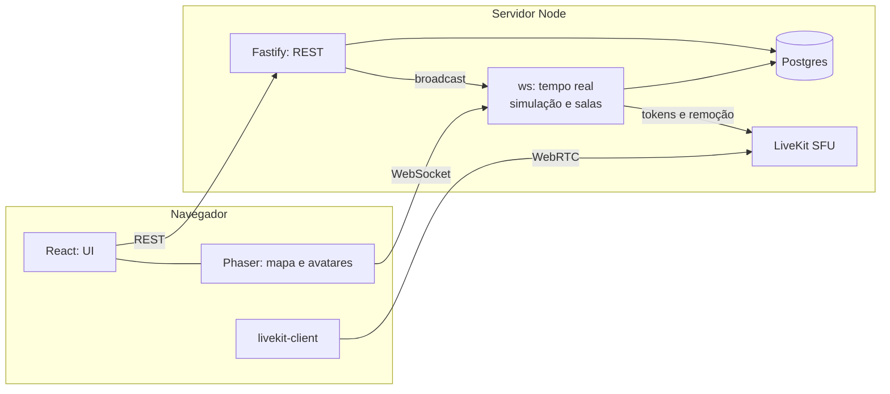

# Pixelwork

Coworking virtual em pixel art 2D. Entre como convidado, explore o escritório, converse por voz e vídeo com quem está perto e participe de reuniões privadas. Cada equipe pode montar seu próprio mapa, personalizar avatares e decorar suas mesas.

O projeto explora colaboração em tempo real com React, Phaser, Fastify, WebSocket, PostgreSQL e LiveKit. O servidor valida o movimento e o acesso às salas, enquanto o cliente prevê os passos e interpola os avatares.


[Como rodar](#como-rodar) · [Telas](#telas) · [Arquitetura](#arquitetura) · [Testes](#testes)

## O que dá para fazer

- **Explorar o escritório.** Ande pelo teclado ou toque no mapa. No celular, use **Mapa** para escolher um destino. Ao chegar perto de um móvel interativo, aparecem ações como sentar ou jogar.
- **Conversar e se reunir.** Use voz, vídeo e chat por proximidade, faça chamadas 1:1 e compartilhe a tela. Na Sala Aurora, a mesa tem dez lugares e a porta distingue os estados aberta, fechada e trancada. Visitantes podem bater e pedir acesso.
- **Personalizar avatar e mesa.** Combine camadas, cores, roupas e acessórios. Escolha itens padrão ou coleções temáticas como Halloween, Natal, Grinch e Ano Novo. A demo inclui decoração de Natal com Max e uma fileira de Halloween.
- **Jogar pingue-pongue e pebolim.** Jogue 1 contra 1 ou enfrente um bot. Quem passa perto vê o placar sobre a mesa. O servidor simula as partidas a 30 Hz.
- **Editar o mapa.** Mova móveis, altere pisos e tapetes, organize mesas individuais, em fileiras ou em espinha e gire as estações de trabalho e mesas de jogos. O editor tem desfazer e refazer e os mapas podem ser importados e exportados no formato do Tiled. Visitantes podem experimentar o editor na demo.
- **Gerenciar espaços.** Crie coworkings por organização, convide pessoas e defina papéis. Para investigar a simulação, use o painel de rede (F3). Admins também podem abrir o replay.

## Telas

| Sala Aurora | Editor de mapas |
| --- | --- |
|  |  |

| Personalização de avatar | Decoração da mesa |
| --- | --- |
|  |  |

| Destinos no celular | Ações no mapa |
| --- | --- |
|  |  |

Capturas feitas na demo local. O mapa de demonstração é restaurado diariamente à meia-noite, no horário de Brasília.

## Como rodar

Precisa de Node 24, pnpm 11 e Docker.

```
cp .env.example .env
pnpm install
docker compose -f docker-compose.dev.yml up -d
pnpm db:migrate
pnpm db:seed
pnpm dev
```

Abrir http://localhost:5173 e entrar como convidado. Para ver outra pessoa, abrir num segundo
perfil do navegador (o cookie é por perfil). O login pelo GitHub é opcional; o passo a passo está no
`.env.example`.

Outros comandos: `pnpm test` (unitários e integração, com o Postgres do compose), `pnpm e2e`,
`pnpm load --bots 50`, `pnpm typecheck`, `pnpm lint`. A lista completa está no `CLAUDE.md`.

### Testar com outra pessoa na rede

Fora do `localhost` o navegador só libera câmera e microfone em https, e a outra máquina precisa
achar o Vite e o LiveKit pelo IP desta. Com o IP desta máquina no lugar de `192.168.0.10`:

1. Gerar um certificado próprio (o Git para Windows já traz o `openssl`):

   ```
   mkdir .certs
   openssl req -x509 -newkey rsa:2048 -nodes -days 365 -keyout .certs/dev.key -out .certs/dev.crt \
     -subj "/CN=Pixelwork dev" -addext "subjectAltName=IP:192.168.0.10,DNS:localhost,IP:127.0.0.1"
   ```

2. Descomentar o bloco "Outra pessoa na mesma rede" do `.env` (está no `.env.example`) com o IP.
3. Recriar o LiveKit para ele anunciar o IP (`docker compose -f docker-compose.dev.yml up -d livekit`)
   e subir com `pnpm dev`.
4. Todo mundo abre `https://192.168.0.10:5173`, inclusive nesta máquina: o servidor só aceita
   escrita vinda do `PUBLIC_URL`. O navegador avisa que o certificado não é confiável; aceitar uma
   vez.

O firewall precisa deixar entrar TCP 5173 (Vite), TCP 7881 e UDP 7882 (mídia do LiveKit). Https em
`localhost` ou IP privado continua sendo desenvolvimento: as checagens de produção do `env.ts` valem
para https em endereço público.

## Recepção de IA em teste local

O NPC **Recepção · IA** aparece em mapas com um ponto de recepção quando a instalação e o coworking autorizam o recurso. Aproxime-se do NPC, leia o aviso e toque em **Conversar com IA**. O modo local detecta os turnos e alterna chamadas de teste às ferramentas de localização, pessoas online e orientação de porta. A saudação e as respostas deste modo são tons sintéticos.

| Decisão | Implementação local |
| --- | --- |
| Processo de voz | Python com SDK RTC LiveKit, supervisionado pelo Pixelwork por IPC. [Spec](docs/superpowers/specs/2026-11-25-recepcionista-ia-design.md) |
| Autoridade de mídia | O servidor emite um token da sala aberta por conversa. A trilha do NPC é autorizada somente ao visitante atendido, e o servidor remove a identidade ao encerrar. |
| Vários visitantes | Um atendimento por coworking, teto global configurável e encerramento ao sair do raio ou mudar de sala. |
| Turnos e dados | Fala detectada cancela a reprodução e limpa a fila. Áudio em memória e contadores de uso por sessão. A síntese e as ferramentas de teste rodam localmente. |

### Ativar o modo de teste

1. Crie um ambiente Python 3.12 fora da pasta do projeto e instale o SDK livre com `python -m pip install livekit==1.3.0`.
2. Aplique `pnpm db:migrate` no banco de desenvolvimento. No `.env`, defina `RECEPTIONIST_ENABLED=true` e `RECEPTIONIST_PYTHON` como o caminho absoluto do executável desse ambiente. Os limites de sessões e de duração estão no `.env.example`.
3. Entre no coworking como admin, abra **Recepção** e autorize o recurso. A demo restaurada a partir do mapa padrão inclui o ponto. Em outro mapa, adicione no Tiled um ponto em uma camada de objetos chamada `reception`, em área aberta e caminhável.

O modo de teste usa o LiveKit self-hosted e os dublês locais. Voz natural, integração com AgentSession, fallback de TTS e orçamento monetário transacional pertencem à próxima etapa, após a escolha autorizada de provedores. Os limites de sessões e tempo já se aplicam ao modo local.

### Tempo até o primeiro áudio sintético

Ensaio no Windows, Ryzen 7 7735HS, Node 24.14.1, CPython 3.12.13, RTC Python 1.3.0 e LiveKit self-hosted v1.13.11 no Docker Desktop da mesma máquina. Tempo entre o fim do trecho sintético no publicador e o primeiro frame audível no receptor RTC Python, após a saudação e com a mesma conversa aquecida. Foram 30 turnos, sem erro na amostra, com STT, LLM e TTS simulados.

| Turnos | p50 | p95 | Faixa |
| ---: | ---: | ---: | ---: |
| 30 | 312 ms | 328 ms | 265–344 ms |

Reprodução com `pnpm exec tsx scripts/reception-worker-smoke.ts caminho/do/python 30`. O ensaio de isolamento de mídia fica em `scripts/reception-rtc-smoke.ts`. O número mede o caminho local sintético e a rede do teste. A medição de voz natural no navegador segue o protocolo da spec.

## Arquitetura



- **Monorepo** com `shared` (protocolo, schema, compilação do mapa, simulação, proximidade, modelo
  do editor), `server` e `client`. A simulação e as regras de proximidade são funções puras em
  `shared`, usadas pelos dois lados e testadas sem rede nem relógio.
- **Movimento:** o cliente manda intenção (`move` com direção e `seq`), nunca posição. O servidor
  aplica no máximo um passo por intervalo e confirma com `ack` no tick; o cliente prevê, faz snap e
  reaplica os passos pendentes quando diverge. Os outros avatares são interpolados.
- **Persistido x efêmero:** o que vai para o banco passa por REST (grava e depois avisa pelo
  WebSocket); movimento, trancas, batidas, chamadas e chat passam só pelo WebSocket.
- **Mídia:** cada cliente está em uma sala do LiveKit por vez, e quem decide qual é o servidor
  (`space:` aberta, `zone:` da reunião, `call:` da chamada). Ao trocar, o servidor emite o token
  novo e remove o participante da sala anterior pela API do LiveKit, o que cobre um cliente
  modificado que ignore o aviso.
- **Mapa:** o formato é o JSON do Tiled, com um contrato validado por `compileMap` (camadas,
  zonas, mesas, spawn, tilesets do catálogo). Upload, editor e templates produzem o mesmo JSON.

Os contratos completos estão em `docs/architecture.md`; a arte e o catálogo de assets, em
`docs/art.md`.

## Decisões e o que ficou de fora

| Escolha | Descartado | Por quê |
|---|---|---|
| Sessão própria, token aleatório com só o hash no banco | JWT, auth como serviço | Revogar é apagar a linha; nenhum serviço externo precisa validar o token |
| LiveKit (SFU) self-hosted | Mesh P2P, mediasoup | Mesh multiplica o upload por participante; mediasoup é baixo nível demais |
| Proximidade calculada no cliente para a sala aberta | Calcular no servidor | A área aberta é visível para todos por definição; o que precisa de privacidade está em salas separadas, autorizadas no servidor |
| Drizzle + Postgres, isolamento de tenant na aplicação | Prisma, RLS, schema por tenant | Schema em TypeScript sem codegen; um backend só não ganha nada com RLS |
| Toda rota `/spaces/:id` resolve a participação uma vez e responde 404 a quem não é membro | 403 | Não vaza a existência do coworking; um teste deriva a lista de rotas do Fastify e falha se uma rota nova ficar de fora |
| Vídeo como `<video>` sobre o canvas | Vídeo como textura no Phaser | Upload de textura por frame sem ganho |
| Concorrência otimista no mapa (`baseVersion`, 409) | Lock de edição | Dois admins raramente editam juntos; o 409 é simples de explicar |
| Vitest, bots em Node com os tipos do protocolo | Jest, k6, Artillery | Sem configuração extra de TypeScript; o teste de carga usa o protocolo real |

## Números de carga

`pnpm load --bots N` sobe o servidor num processo filho, entra N convidados no coworking de demo e
faz cada um andar aleatoriamente (um passo a cada ~160 ms). A latência é do tick: do envio pelo
servidor (`ts` do tick) ao recebimento pelo bot. Medido numa máquina de desenvolvimento Windows,
com servidor e bots na mesma máquina, 30 s de medição depois de 5 s de aquecimento:

| Bots | Latência p50 | p95 | p99 | Tick médio | Mensagens por bot/s | CPU do servidor | Memória (RSS) |
|-----:|-----:|-----:|-----:|-----:|-----:|-----:|-----:|
| 10 | 7 ms | 8 ms | 9 ms | 347 B | 9,5 | 3,8% | 97 MB |
| 25 | 3 ms | 4 ms | 6 ms | 810 B | 9,7 | 5,8% | 98 MB |
| 50 | 6 ms | 9 ms | 12 ms | 1.555 B | 9,9 | 8,9% | 102 MB |

O tick cresce linearmente com quem se moveu (todo o coworking vai para todos, sem área de
interesse), e a CPU fica abaixo de 10% de um núcleo com 50 pessoas andando sem parar. Os bots
rodam num único processo Node, então parte da latência é fila do próprio cliente de teste.

Tick binário (revisão de 2026-11): com ids curtos e 5 bytes por movimento, o tick médio com 50
bots caiu de 1.559 B (JSON, código anterior) para 154 B, medidos na mesma máquina (macOS, 20 s
de medição). A CPU do servidor ficou na mesma faixa (4,1% contra 5,0%, dentro do ruído da
medição):

| Bots | Latência p50 | p95 | p99 | Tick médio | Mensagens por bot/s | CPU do servidor |
|-----:|-----:|-----:|-----:|-----:|-----:|-----:|
| 10 | 0 ms | 1 ms | 1 ms | 44 B | 9,9 | 1,7% |
| 25 | 1 ms | 1 ms | 1 ms | 86 B | 10,3 | 3,4% |
| 50 | 1 ms | 2 ms | 2 ms | 154 B | 10,2 | 5,0% |

## Testes

- Unitários: `compileMap` com uma fixture por código de erro (e um teste de custo com retângulos
  gigantes), simulação, proximidade com histerese, reconciliação, interpolação, A*, codec do tick
  binário, replay, validação do ambiente, comandos do editor (ida e volta exata e sequências
  aleatórias com semente fixa).
- Integração: servidor no processo de teste, porta aleatória, relógio manual e banco criado e
  apagado por execução. Bots WebSocket cobrem entrada, saída, tolerância de reconexão, limites de
  taxa, trancas, batidas, chamadas e a autorização de mídia contra um dublê do LiveKit. Também:
  ECONNRESET no meio do upgrade, falha do banco ao carregar o runtime, logout e expiração fechando
  o WebSocket, fila de passos adiantados, replay chegando às mesmas posições do servidor,
  `/metrics` e o limite de taxa HTTP.
- E2E de fumaça (Playwright, dois contextos do Chromium com mídia falsa): um anda até o outro e o
  teste confere que a trilha remota foi assinada. Roda no CI com o LiveKit num container.
- Renderização do Phaser e layout do React não têm teste automatizado; a lógica fica fora das
  cenas.

## Limites conhecidos e o caminho para escalar

Hoje é um nó só: o estado de tempo real (posições, trancas, chamadas) vive na memória do processo,
e um coworking inteiro recebe os movimentos de todos. Para crescer:

1. **Coworkings distribuídos entre nós:** cada coworking pertence a um nó (hash do id); o
   balanceador encaminha o WebSocket pelo `space`. O estado continua em memória, só que espalhado.
2. **Avisos entre nós:** a rota REST grava no banco e publica num Redis; o nó dono do coworking
   faz o broadcast.
3. **Área de interesse:** mandar no tick só quem está perto da câmera de cada cliente, quando um
   coworking passar de algumas centenas de pessoas. O tick binário já cortou o tamanho por
   movimento em ~10x, o que adia essa necessidade.
4. **LiveKit em cluster:** o LiveKit já escala horizontalmente com Redis; o servidor só emite
   tokens.

O [guia de deploy](docs/deploy.md) descreve como rodar a aplicação em uma VPS com Caddy, TLS, PostgreSQL e LiveKit.

## Arte

A pixel art é gerada em código com `pnpm assets:art`, a partir de `scripts/art/`. A paleta Resurrect 64 e os tons de carvalho são usados em pisos, tapetes, móveis e avatares. O catálogo reúne itens padrão e temáticos, com prévias no editor e na personalização.

O guia de estilo, as licenças e os créditos estão em [docs/art.md](docs/art.md) e na página `/creditos` do app.
